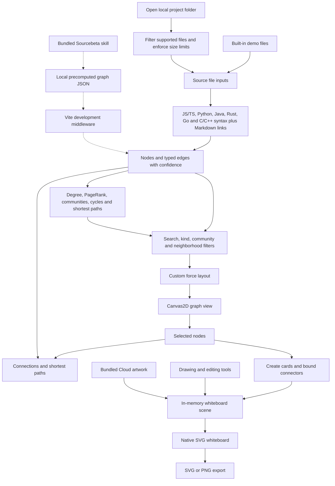

# Sourcebeta

A local code knowledge graph and whiteboard for exploring JavaScript, TypeScript, Python, Java, Rust, Go, C/C++, and Markdown projects. Follow dependencies, inspect related symbols, and turn selected nodes into editable architecture diagrams.

Sourcebeta implements its own Canvas2D graph renderer, force layout, community detection, PageRank, cycle detection, shortest paths, and SVG whiteboard. Obsidian, Graphify, and Excalidraw are product inspirations, not embedded runtimes. React provides the UI; the TypeScript compiler API and Lezer grammars parse source locally. No parser executes the project being inspected.

## Quick start

Install Bun, then run these commands from this repository's root:

```bash
bun install --frozen-lockfile
bun run --bun dev --host 127.0.0.1
```

Open the local URL printed by Vite, normally `http://127.0.0.1:5173`. If that port is occupied, Vite selects another one. The app starts with a small demo project; no account, API key, database, or backend service is required.

Use a current desktop browser. Chromium-based browsers support the native directory picker; other browsers use a folder-input fallback where supported.

## Explore a project

1. Click **Open folder** and choose the repository to inspect, or use **Demo project** to try the built-in example.
2. Search by symbol name or file path. Filter files, functions, classes, notes, or communities.
3. Click a node to inspect its numbered source, incoming/outgoing connections, degree, PageRank, community, and dependency-cycle membership. **Whole file** displays all the file's text; **Symbol** returns to the selected definition. Collapse **Source** to give connections more room. Ctrl/Cmd-click adds or removes nodes from the selection.
4. Use **Select neighbors** or **Local graph around selection** to focus on a one- or two-hop neighborhood.
5. Choose a target in **Shortest path** to see a connecting route. On larger graphs, **Filter targets** searches a bounded list instead of rendering every node. Paths and neighborhoods traverse relationships in either direction, even though graph edges retain their direction.
6. Click **Send nodes to canvas** to create architecture cards and bound connectors from the selection.

Drag a graph node to move and pin it. Drag the background to pan, scroll to zoom around the pointer, and use **Fit graph** to frame the visible nodes.

### Understand the graph

| Item | Meaning |
| --- | --- |
| File | A supported source file |
| Function or class | A declaration, method, nested function/class, callback, or lambda found by the analyzer |
| Note | A Markdown file |
| `imports` | A resolved local import or re-export |
| `contains` | A file, class, or function owns a nested symbol |
| `calls` | A recognized identifier call between symbols |
| `links` | A Markdown `[[wikilink]]` or a local Markdown file link |
| `EXTRACTED` | Connected directly through supported source syntax/name resolution |
| `INFERRED` | Matched through a name that is unique across the project; confirm it in source |

Node colors represent communities, and node sizes reflect degree. Community detection uses deterministic label propagation, not Louvain. The **Key nodes** list shows up to five connected nodes with the highest PageRank (degree breaks ties). PageRank uses damping 0.85 with at most 30 normalized passes, including dangling-node redistribution. Dependency cycles are strongly connected components found with iterative Tarjan traversal, so deep graphs do not hit recursion limits. Neighborhoods and connection details use a cached adjacency index, and shortest paths use bidirectional breadth-first search.

## Draw on the whiteboard

- Select, drag, resize, duplicate, delete, or multi-select objects.
- Draw rectangles, ellipses, diamonds, arrows, freehand paths, and editable text.
- Hold Shift while drawing an ellipse to make a circle or while resizing to preserve proportions.
- Connect shapes with arrows; bound endpoints follow the shapes when they move.
- Adjust stroke, fill, width, and grid visibility; use undo/redo while editing.
- Open the Cloud library to insert one of 19 bundled artwork groups.
- Export **SVG** for vector output or **PNG** for an image.

Code cards include the selected graph nodes; connections between selected nodes become arrows, except `contains` and self links. Repeated handoffs append new cards without replacing the drawing.

The Cloud `.excalidrawlib` file is imported artwork data. Sourcebeta converts its supported shapes into its own SVG elements; it does not load the Excalidraw editor. The artwork retains its original ownership; this repository does not grant additional rights to third-party artwork.

**Persistence:** the scene survives switching between Graph and Canvas in the current page. Reloading or closing the page loses it. There is no saved-scene import, autosave, or collaborative storage; export before leaving.

## How it works



### Main files

| File | Responsibility |
| --- | --- |
| `src/App.tsx` | Project loading, filters, selection, graph analytics, and whiteboard scene state |
| `src/lib/loadFiles.ts` | Browser folder loading and input limits |
| `src/lib/analyzer.ts` | TypeScript traversal, language dispatch, scoped import/call resolution, notes, and source text |
| `src/lib/python.ts` | Python classes, methods, nested functions, lambdas, imports, and source ranges |
| `src/lib/java.ts`, `rust.ts`, `go.ts`, `cpp.ts` | Lezer-based symbols, imports, receiver inference, and package/module/include resolution |
| `src/lib/lezer.ts` | Shared Lezer source ranges, qualified symbol IDs, and import edges |
| `src/components/SourceView.tsx` | Numbered symbol source and full-file inspection |
| `src/lib/analytics.ts` | Cached graph index, PageRank, Tarjan cycles, communities, bidirectional paths, and connection details |
| `src/lib/layout.ts` | Deterministic seeding, bounded force simulation, fitting, and hit testing |
| `src/components/GraphView.tsx` | Canvas2D painting, graph interactions, and animation frames |
| `src/lib/canvas.ts` | Native board model, connector geometry, graph-to-card conversion, and artwork import |
| `src/components/CanvasView.tsx` | SVG shapes, editing, history, library, and export |
| `vite.config.ts` | Optional development-only precomputed graph endpoint |
| `scripts/browser-check.mjs` | End-to-end graph and whiteboard checks |

### Rendering choices

The graph simulation and painting run through `requestAnimationFrame` rather than React state updates on every simulation tick. Spatial sampling bounds repulsion work, and the simulation stops after settling or its tick limit.

The TypeScript compiler, Lezer grammars, and analyzer are code-split into a separate chunk and imported only when a folder or the demo is analyzed. Precomputed project views (`?project=1`) do not download that chunk. The current production shell is about 270 kB before gzip; the lazy analyzer chunk is about 3.9 MB (1.13 MB gzip), dominated by the TypeScript compiler.

`App.tsx` memoizes analytics, connection details, and shortest paths. `BoardShape` uses React's `memo`, including recursive artwork rendering. Its scene-array prop still changes when the scene is edited, so this wrapper does not eliminate all drag-time renders; bound arrows must update when their endpoint shapes move.

## Claude Code skill

The repository includes a Claude Code skill at `.claude/skills/sourcebeta/SKILL.md` and a portable Bun launcher beside it. It gives Claude a graph-guided problem-solving workflow without Graphify or an MCP server: find related files and callers, confirm behavior in source, make a minimal change, and verify it with tests.

### Use in this repository

Run `bun install --frozen-lockfile`, then start Claude Code in the Sourcebeta checkout. Claude discovers the project skill and can use it when its description matches the task. Invoke it explicitly with, for example:

```text
/sourcebeta Trace how arrowPoints keeps connectors attached to moved cards.
/sourcebeta Investigate graph selection in GraphView.tsx and identify relevant tests.
/sourcebeta Open the graph for this project.
```

Use a current Claude Code version with skill-directory variable support. The skill uses `${CLAUDE_SKILL_DIR}` so script paths work independently of the shell's current directory. It does not grant additional tool permissions; Claude's normal approval rules still apply.

### Use across other projects

From this checkout, copy the skill to Claude Code's personal skills directory. These commands are for Bash/Git Bash:

```bash
export SOURCEBETA_HOME="$PWD"
mkdir -p "$HOME/.claude/skills"
test ! -e "$HOME/.claude/skills/sourcebeta" && \
  cp -R .claude/skills/sourcebeta "$HOME/.claude/skills/sourcebeta"
```

If that skill directory already exists, review it before replacing it; the command deliberately does not overwrite it. Keep this Sourcebeta checkout and its installed dependencies. Start Claude Code in the target project from a shell with `SOURCEBETA_HOME` set to this checkout's absolute path. Set it again in new shells, or manage it in your own shell configuration. Restart an existing Claude session if the copied skill is not discovered.

For a project-only installation elsewhere, copy the same `sourcebeta` skill folder into that project's `.claude/skills/` directory and set `SOURCEBETA_HOME` in the launching shell. The existing separately installed Qoder skill is unaffected.

### Run analysis directly

```bash
# From this checkout; target any supported project.
bun .claude/skills/sourcebeta/scripts/sourcebeta.mjs /path/to/project \
  --query "symbol-or-file"

# Start the loopback development server and open the graph only when requested.
bun .claude/skills/sourcebeta/scripts/sourcebeta.mjs /path/to/project --open
```

Omit the target path to scan the current working directory. Queries match symbol names and paths by case-insensitive substring, not semantic search. Output includes source locations and confidence labels, capped at five key nodes, eight matches, and five connections per match; follow up with source reads/searches for complete impact analysis.

Analysis alone prints a bounded summary, without opening a browser or writing a graph cache. `--open` writes the graph **and complete supported-file source text** under the operating system's temporary directory, starts or reuses a localhost Vite server, and opens `?project=1`. The app loads that graph through `/api/sourcebeta/project`; this endpoint exists only in the development server. Keep these caches private and the server on loopback: source may contain credentials or other sensitive data. Sourcebeta does not execute the scanned project's code.

```mermaid
flowchart LR
    Problem[User problem] --> Skill[Claude invokes Sourcebeta skill]
    Skill --> Query[Focused local graph query]
    Query --> Evidence[Locations, callers and dependencies]
    Evidence --> Read[Claude reads relevant source and tests]
    Read --> Fix[Minimal evidence-based change]
    Fix --> Verify[Tests and browser checks when applicable]
    Verify --> Report[Result and remaining limitations]
```



The graph is navigation assistance, not proof of runtime behavior. Claude still reasons about the problem and performs the change; Sourcebeta does not guarantee a correct fix or measured token savings.

## Limits and privacy

- Supported extensions: `.ts`, `.tsx`, `.js`, `.jsx`, `.mjs`, `.cjs`, `.py`, `.pyi`, `.java`, `.rs`, `.go`, `.c`, `.h`, `.cc`, `.cpp`, `.cxx`, `.hpp`, `.hh`, `.hxx`, `.md`, and `.markdown`. Other languages are not indexed.
- Folder loading and the skill launcher accept at most 2,000 supported files and skip files larger than 1,000,000 bytes. They ignore common dependency, build, VCS, Python cache, and virtual-environment directories.
- The app reports when the limit or size cap omits files; the launcher prints the same warnings. Source is complete only for files accepted by that scan.
- Symbol discovery recursively includes functions, classes, methods, nested definitions, callbacks, wrapped functions, closures, and lambdas. Java records/annotations, Rust structs/enums/traits/impls, Go named types and receiver methods, C/C++ namespaces and out-of-line methods are included. C/C++ prototypes merge with matching definitions; TypeScript overloads share a symbol; repeated Python definitions retain separate IDs. Syntax unsupported by the parsers may be incomplete.
- Selected symbols show numbered source ranges, including decorators; **Whole file** shows all lines. Lines are text, not individual graph nodes. Comments, imports, and other non-symbol statements remain accessible in file source.
- TypeScript resolves relative local imports, not package aliases. Python resolves local modules/packages, relative imports, and conventional `src` roots. Java resolves packages, static/wildcard imports, and common `src/main/java` roots. Rust resolves `crate`/`self`/`super`, `mod`, and nested `use` trees. Go resolves package directories by unique import-path suffix, dot imports, same-package files, and package-level constructor return types. C/C++ resolves quoted includes by relative path or unique suffix. Re-export forwarding and arbitrary import-path configuration are not fully resolved.
- Calls use lexical scopes, imports, package namespaces, and recognized receiver types, with a unique top-level-name fallback labeled `INFERRED`. Arbitrary receiver expressions, dynamic dispatch, macros/templates with dependent types, and shadowing beyond recognized parameters/definitions can remain unresolved or ambiguous. Even `EXTRACTED` edges are not exhaustive runtime analysis.
- Markdown connects `[[wikilinks]]` and simple inline local Markdown file links. Reference-style links, encoded paths, and full Markdown semantics are not supported.
- Analysis runs locally and does not upload project files to an external service. The graph carries source text once per file; precomputed caches also contain it.
- The project endpoint accepts only loopback GET requests and sends `no-store`/`nosniff` headers. On POSIX, the skill creates its temporary source cache with user-only permissions. Keep development servers on loopback and do not copy or publish caches.
- The lazy parser/analyzer chunk is still large because it bundles the TypeScript compiler, so the production build emits a large-chunk warning for it. This affects analyzer startup, not the initial shell or precomputed project views.

## Development and verification

```bash
bun run --bun lint
bun run --bun test
bun scripts/skill-check.mjs
bun run --bun build
```

The unit suite covers TypeScript, Python, Java, Rust, Go, and C/C++ extraction, nested scopes, source ranges, cross-file imports/packages, malformed input, determinism, PageRank, Tarjan cycles, bidirectional shortest paths, native board geometry/artwork, and force layout. The skill checks validate metadata, focused output including Python and Java symbols, scan limits, error cases, and using a copied skill from another project.

For browser verification, install Microsoft Edge and keep the development server running in another terminal:

```bash
# Defaults to the server at http://127.0.0.1:5173.
bun scripts/browser-check.mjs

# Bash/Git Bash: use this if Vite selected another port.
SOURCEBETA_URL=http://127.0.0.1:5174 bun scripts/browser-check.mjs
```

The browser checks exercise graph selection/filtering/pan/zoom, card handoff, connectors, drawing, undo/redo, Cloud artwork, exports, malformed-library handling, and a synthetic 6,000-node graph. Screenshots and exports go into the ignored `artifacts/` directory; dependencies and build output are also excluded from Git.

To preview the static production build:

```bash
bun run --bun preview --host 127.0.0.1
```

The demo and folder-picker workflow work in the static app; the optional precomputed-project endpoint requires the development server.
