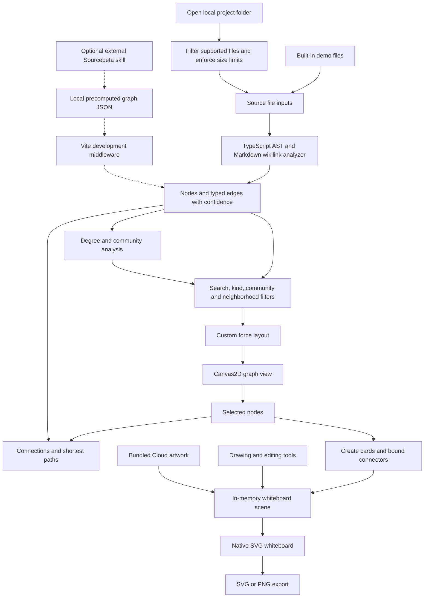

# Sourcebeta

A local code knowledge graph and whiteboard for exploring JavaScript, TypeScript, and Markdown projects. Follow dependencies, inspect related symbols, and turn selected nodes into editable architecture diagrams.

Sourcebeta implements its own Canvas2D graph renderer, force layout, community detection, and SVG whiteboard. Obsidian, Graphify, and Excalidraw are product inspirations, not embedded runtimes. React provides the UI, and the TypeScript compiler API parses source files.

## Quick start

Install Bun, then run these commands from this repository's root:

```bash
bun install --frozen-lockfile
bun run --bun dev --host 127.0.0.1
```

Open the local URL printed by Vite, normally `http://127.0.0.1:5173`. If that port is occupied, Vite selects another one. The app starts with a small demo project; no account, API key, database, or backend service is required.

Use a current desktop browser. Chromium-based browsers support the native directory picker; other browsers use a folder-input fallback where supported.

## Explore a project

1. Click **Open folder** and choose the repository to inspect, or use **Demo project** to try the built-in example.
2. Search by symbol name or file path. Filter files, functions, classes, notes, or communities.
3. Click a node to inspect its source location, incoming/outgoing connections, and degree. Ctrl/Cmd-click adds or removes nodes from the selection.
4. Use **Select neighbors** or **Local graph around selection** to focus on a one- or two-hop neighborhood.
5. Choose a target in **Shortest path** to see a connecting route. Paths and neighborhoods traverse relationships in either direction, even though graph edges retain their direction.
6. Click **Send nodes to canvas** to create architecture cards and bound connectors from the selection.

Drag a graph node to move and pin it. Drag the background to pan, scroll to zoom around the pointer, and use **Fit graph** to frame the visible nodes.

### Understand the graph

| Item | Meaning |
| --- | --- |
| File | A supported source file |
| Function or class | A top-level declaration found by the analyzer |
| Note | A Markdown file |
| `imports` | A resolved local import or re-export |
| `contains` | A file owns a symbol |
| `calls` | A recognized identifier call between symbols |
| `links` | A Markdown `[[wikilink]]` resolved by note title |
| `EXTRACTED` | Connected directly through supported source syntax/name resolution |
| `INFERRED` | Matched through a name that is unique across the project; confirm it in source |

Node colors represent communities, and node sizes reflect degree. Community detection uses deterministic label propagation, not Louvain. The **Key nodes** list shows up to five nodes with the highest positive degree.

## Draw on the whiteboard

- Select, drag, resize, duplicate, delete, or multi-select objects.
- Draw rectangles, ellipses, diamonds, arrows, freehand paths, and editable text.
- Hold Shift while drawing an ellipse to make a circle or while resizing to preserve proportions.
- Connect shapes with arrows; bound endpoints follow the shapes when they move.
- Adjust stroke, fill, width, and grid visibility; use undo/redo while editing.
- Open the Cloud library to insert one of 19 bundled artwork groups.
- Export **SVG** for vector output or **PNG** for an image.

Code cards include the selected graph nodes; connections between selected nodes become arrows, except `contains` and self links. Repeated handoffs append new cards without replacing the drawing.

The Cloud `.excalidrawlib` file is imported artwork data. Sourcebeta converts its supported shapes into its own SVG elements; it does not load the Excalidraw editor. The artwork retains its original ownership; this repository does not grant additional rights to third-party artwork.

**Persistence:** the scene survives switching between Graph and Canvas in the current page. Reloading or closing the page loses it. There is no saved-scene import, autosave, or collaborative storage; export before leaving.

## How it works



### Main files

| File | Responsibility |
| --- | --- |
| `src/App.tsx` | Project loading, filters, selection, graph analytics, and whiteboard scene state |
| `src/lib/loadFiles.ts` | Browser folder loading and input limits |
| `src/lib/analyzer.ts` | Source parsing, import/call resolution, notes, and edge deduplication |
| `src/lib/analytics.ts` | Degree, communities, neighborhoods, paths, and connection details |
| `src/lib/layout.ts` | Deterministic seeding, bounded force simulation, fitting, and hit testing |
| `src/components/GraphView.tsx` | Canvas2D painting, graph interactions, and animation frames |
| `src/lib/canvas.ts` | Native board model, connector geometry, graph-to-card conversion, and artwork import |
| `src/components/CanvasView.tsx` | SVG shapes, editing, history, library, and export |
| `vite.config.ts` | Optional development-only precomputed graph endpoint |
| `scripts/browser-check.mjs` | End-to-end graph and whiteboard checks |

### Rendering choices

The graph simulation and painting run through `requestAnimationFrame` rather than React state updates on every simulation tick. Spatial sampling bounds repulsion work, and the simulation stops after settling or its tick limit.

`App.tsx` memoizes graph analysis, connection details, and shortest paths. `BoardShape` uses React's `memo`, including recursive artwork rendering. Its scene-array prop still changes when the scene is edited, so this wrapper does not eliminate all drag-time renders; bound arrows must update when their endpoint shapes move.

## Optional agent workflow

The separately installed user-level **Sourcebeta skill** can scan another project, print focused graph context, and launch this app against a precomputed graph. The skill and its launcher are **not bundled in this repository**; the folder-picker workflow above works without them.

If the skill is already installed, these examples work in Bash/Git Bash from the repository root:

```bash
export SOURCEBETA_HOME="$PWD"

# Analyze a project, launch a local server, and open its graph.
bun "$HOME/.qoder/skills/sourcebeta/scripts/sourcebeta.mjs" /path/to/project

# Print focused graph context without starting or opening the UI.
bun "$HOME/.qoder/skills/sourcebeta/scripts/sourcebeta.mjs" /path/to/project \
  --no-open --query "symbol or file name"
```

Replace `/path/to/project` with the target directory. The helper uses `SOURCEBETA_HOME` to locate this app and requires its dependencies to be installed. It writes graph metadata to the operating system's temporary directory; the app loads it through `/api/sourcebeta/project` when opened with `?project=1`. That endpoint exists in the Vite development server, not the static production build.

For implementation work, use matching nodes to choose which files to read, verify inferred edges in source, make the smallest correct change, and run the relevant tests. The graph is navigation assistance, not proof of runtime behavior or a substitute for reading code.

## Limits and privacy

- Supported extensions: `.ts`, `.tsx`, `.js`, `.jsx`, `.mjs`, `.cjs`, `.md`, and `.markdown`.
- Folder loading accepts at most 2,000 supported files and skips files larger than 1,000,000 bytes, plus common dependency/build directories.
- The analyzer resolves relative local imports, not package imports or TypeScript path aliases. It is not a full type-checked language-server index.
- Symbol discovery covers top-level functions/classes and directly assigned function expressions/arrows. Methods are not separate nodes, and functions wrapped in calls such as `memo(...)` are not discovered as standalone function nodes.
- Calls use identifier/name resolution; dynamic dispatch, property-access calls, and alias-heavy code may be incomplete. Even `EXTRACTED` edges reflect this analyzer's supported rules, not exhaustive runtime analysis.
- Markdown links currently use `[[wikilinks]]` and note titles, not general Markdown link resolution.
- Analysis runs locally. The normal folder-picker workflow does not upload project files to an external service. Keep the development server on loopback, especially when serving precomputed project metadata.
- The browser bundles the TypeScript parser, so the production build currently emits a large-chunk warning. This is separate from interactive rendering performance.

## Development and verification

```bash
bun run --bun lint
bun run --bun test
bun run --bun build
```

The current unit suite contains 30 tests covering the analyzer, analytics, native board geometry/artwork, and force layout.

For browser verification, install Microsoft Edge and keep the development server running in another terminal:

```bash
# Defaults to the server at http://127.0.0.1:5173.
bun scripts/browser-check.mjs

# Bash/Git Bash: use this if Vite selected another port.
SOURCEBETA_URL=http://127.0.0.1:5174 bun scripts/browser-check.mjs
```

The browser checks exercise graph selection/filtering/pan/zoom, card handoff, connectors, drawing, undo/redo, Cloud artwork, exports, malformed-library handling, and a synthetic 6,000-node graph. Screenshots and exports go into the ignored `artifacts/` directory; dependencies and build output are also excluded from Git.

To preview the static production build:

```bash
bun run --bun preview --host 127.0.0.1
```

The demo and folder-picker workflow work in the static app; the optional precomputed-project endpoint requires the development server.
